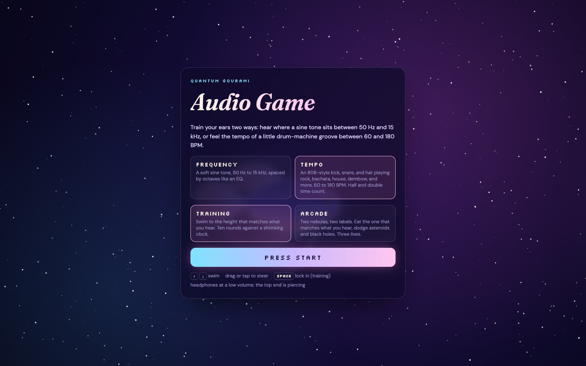
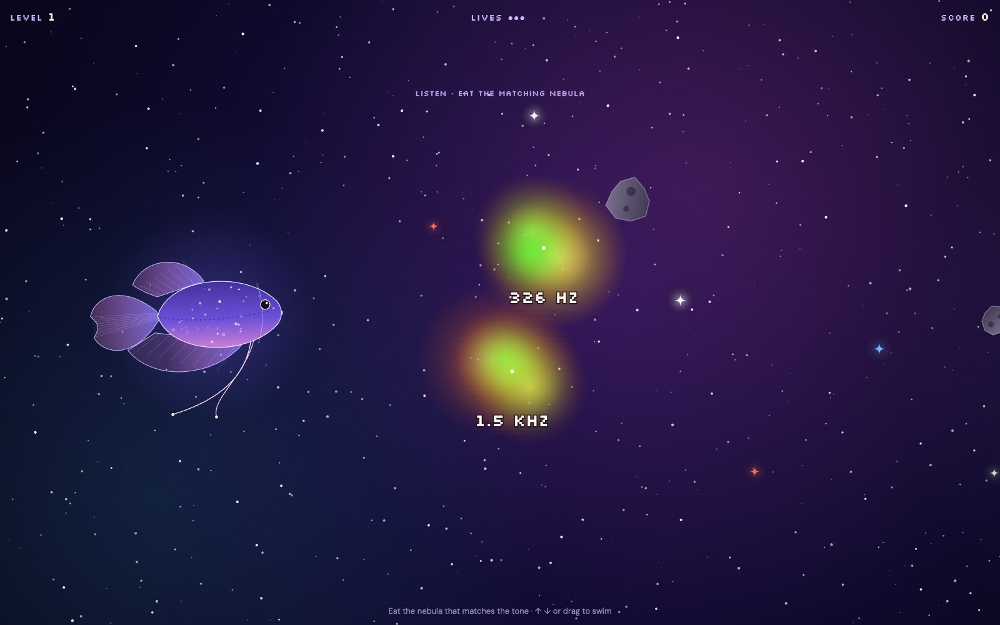
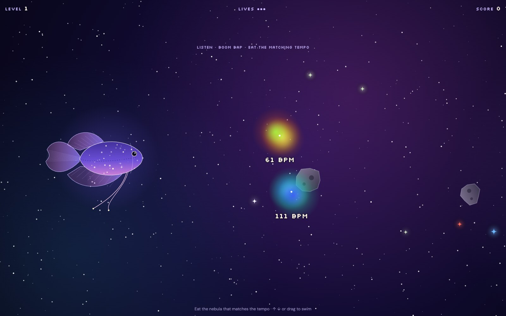

Every audio engineer eventually learns to hear a frequency and name it: the 250 Hz mud in a vocal, the 3 kHz edge on a snare, the ringing note you need to notch out of a room. Musicians and producers learn the same thing for tempo: is that groove 92 or 98 BPM? Quantum Gourami Audio Game is a small browser game for practicing both, starring the celestial gourami from my Quantum Gourami poster.

<a class="button" href="https://anishohmyghosh.github.io/quantum-gourami-games/">Play the Game</a>

First you pick what to train.

**Frequency.** A soft sine tone plays somewhere between 50 Hz and 15 kHz, and the sky is laid out like an EQ, from the lows at the bottom to the highs at the top, spaced by octaves.

**Tempo.** A tiny drum machine I built into the game plays a kick, snare, and hat with 808-style synthesis. Each round it picks a groove (rock, bachata, house, boom bap, dembow, trap, bossa, or breakbeat) and a tempo between 60 and 180 BPM. Feeling it in half time or double time counts too.

Then you pick how to play.

**Training.** Swim your gourami to the height that matches what you hear before the time bar runs out. There are ten rounds, and the clock gets faster every round. You score by how close you land: within a twelfth of an octave, or two BPM, is a Perfect.

**Arcade.** Two nebulas drift toward you, each labeled with a frequency or a tempo. Eat the one that matches what you hear. Every nebula is a real one (Orion, Crab, Helix, Cat's Eye), and the stardust you snack on along the way tells you what kind of star it was, from comet dust to the rare neutron star. Asteroids and black holes cost a life. Every three right answers, the two choices move closer together and space speeds up.

It works on phones too: drag to steer, or use the on-screen arrows. Headphones at a low volume are best, since the top end is piercing.

I built it in an afternoon with Claude Code as a fun side quest while working on an application portfolio. The gourami is drawn in code, so its fins, tail, and feelers move on their own as it swims, and every drum sound is synthesized live in the browser. The source is on GitHub.

<a class="button" href="https://github.com/anishohmyghosh/quantum-gourami-games">View the Code</a>
