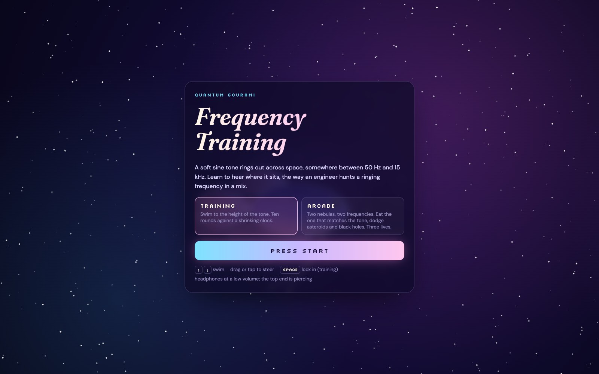
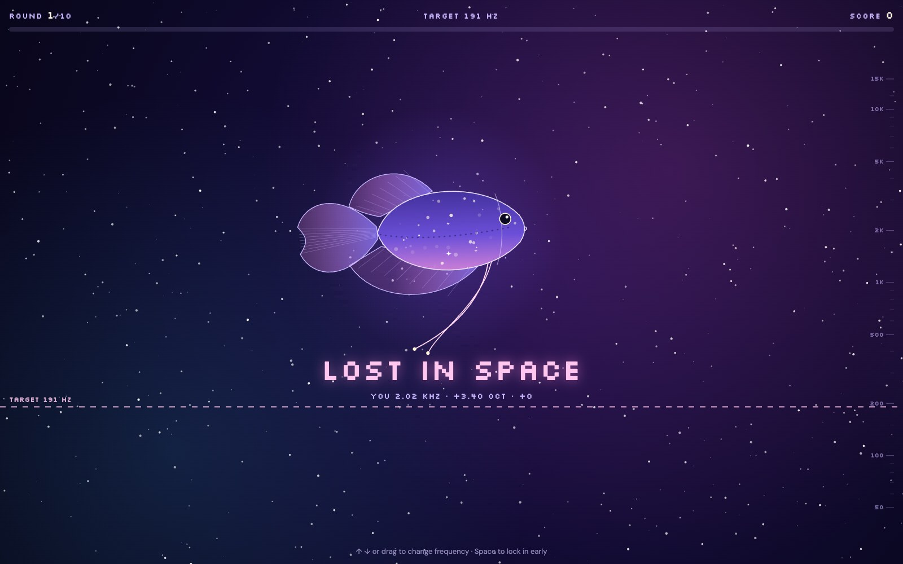

Every audio engineer eventually learns to hear a frequency and name it: the 250 Hz mud in a vocal, the 3 kHz edge on a snare, the ringing note you need to notch out of a room. Quantum Gourami Frequency Training is a small browser game for practicing exactly that, starring the celestial gourami from my Quantum Gourami poster.

<a class="button" href="https://anishohmyghosh.github.io/quantum-gourami-games/">Play the Game</a>

The game has two modes.

**Training.** A soft sine tone plays and your gourami floats in the middle of space. The sky is laid out like an EQ, from 50 Hz at the bottom to 15 kHz at the top, spaced by octaves. Swim to the height of the tone before the time bar runs out. There are ten rounds, and the clock gets faster every round. Landing within a twelfth of an octave is a Perfect, and within a third of an octave is Close.

**Arcade.** Two nebulas drift toward you, each labeled with a frequency, while a tone plays. Eat the one that matches. Every nebula is a real one (Orion, Crab, Helix, Cat's Eye), and the stardust you eat along the way tells you what kind of star it was, from comet dust to the occasional neutron star. Asteroids and black holes cost a life. Every three right answers, the two frequencies move closer together and space speeds up.

It works on phones too: drag to steer, or use the on-screen arrows. Headphones at a low volume are best, since the top end is piercing.

I built it in an afternoon with Claude Code as a fun side quest while working on an application portfolio. The gourami is drawn with code, so its fins, tail, and feelers move on their own as it swims. The source is on GitHub.

<a class="button" href="https://github.com/anishohmyghosh/quantum-gourami-games">View the Code</a>
